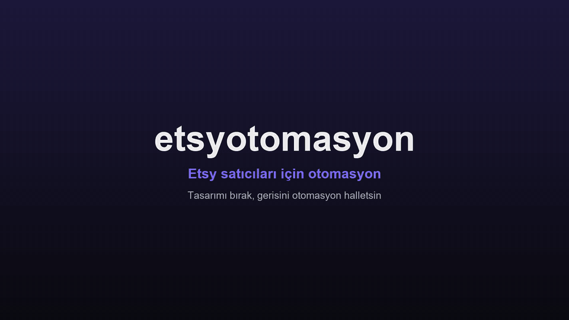
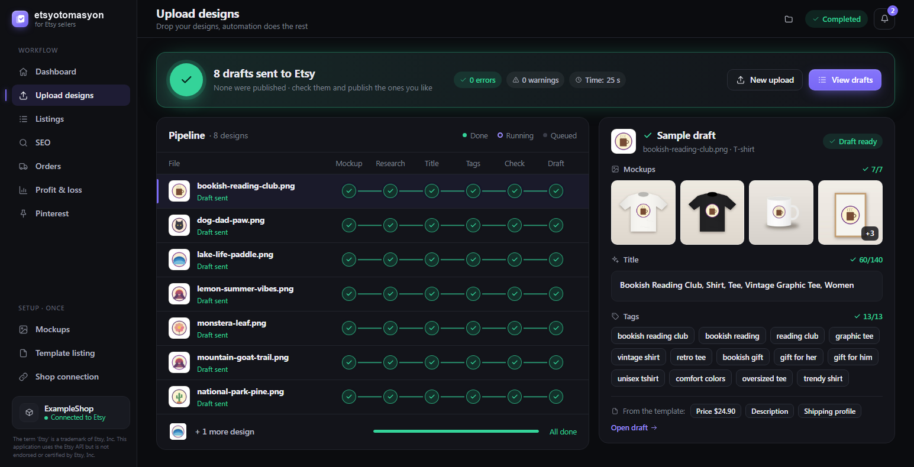
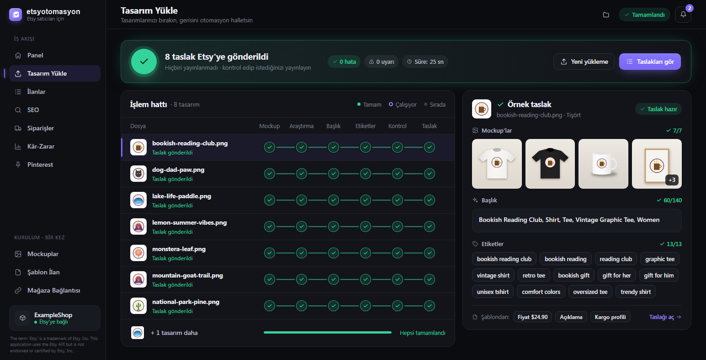

# etsyotomasyon

<p align="center"><a href="docs/etsyotomasyon-demo-tr.mp4"></a></p>

**Demo / Demo video:** [Türkçe](docs/etsyotomasyon-demo-tr.mp4) · [English](docs/etsyotomasyon-demo-en.mp4)

[](https://github.com/wj-sidiss/etsy-otomasyon-full-full-surum/actions/workflows/ci.yml)
[](https://www.python.org/downloads/)
[](LICENSE)
[](https://developers.etsy.com/documentation/)

**Türkçe:** [Kurmadan önce okuyun](#kurmadan-önce-okuyun) · [Türkçe bölümün tamamı](#türkçe)

etsyotomasyon takes the repetitive part of running an Etsy shop off your hands, on your own
computer. Double-click it and it opens in your browser at `http://localhost:3000`. Drop
your designs in, and each one becomes an Etsy **draft** with your mockups, a researched
title and 13 tags. Nothing is published until you choose to publish it. Listings, SEO,
orders and tracking, profit and Pinterest each have their own screen.

It talks to the official **Etsy Open API v3** through your own free Etsy app. There is no
account to create, no subscription and no server in between. Your keys, your shop
connection and your files stay on your computer.



*The Upload designs screen after a run, with invented demo data.*

> The term 'Etsy' is a trademark of Etsy, Inc. This application uses the Etsy API but is not endorsed or certified by Etsy, Inc.

---

## Kurmadan önce okuyun

etsyotomasyon mağazanıza **kendi Etsy uygulamanız** üzerinden bağlanır. Etsy bunu her satıcıdan
ister ve bir kez yapılır. Bu adımları sırayla yapın; çoğu kurulum hatası bir adım
atlandığı için çıkar.

1. **Açık bir Etsy mağazanız olsun.** etsyotomasyon var olan bir mağazayı yönetir.
2. **Etsy uygulaması oluşturun:** <https://www.etsy.com/developers/register-seller-app>
   (*Create a seller app*). Adında "Etsy" kelimesi **geçmesin**, Etsy bunu reddeder.
   Developer Mode'u açmayın. Etsy hesap başına bir uygulamaya izin verir; zaten bir
   uygulamanız varsa onu kullanın.
3. **Onayı bekleyin.** Genelde birkaç dakika sürer. Onaylanmadan anahtarlar çalışmaz.
4. **Callback adresini ekleyin. Bu adım en çok atlanan adımdır.**
   <https://www.etsy.com/developers/your-apps> → uygulamanızın yanındaki **⋮** →
   **Edit callback URLs** → şu adresi **birebir** ekleyip kaydedin:

   ```
   http://localhost:3003/oauth/redirect
   ```

   `https` değil `http`; `127.0.0.1` değil `localhost`; sonunda `/` yok. Bu menü
   uygulama onaylandıktan sonra görünür. etsyotomasyon'in **Mağaza Bağlantısı** ekranı adresi
   bir kopyalama düğmesiyle gösterir.
5. **Anahtarları kopyalayın:** aynı sayfadaki **Keystring** ve **Shared secret** (göz
   ikonu). İkisi birden gerekir ve aynı uygulamadan olmalı.
6. **etsyotomasyon'i indirip açın:** [en son sürüm](https://github.com/wj-sidiss/etsy-otomasyon-full-full-surum/releases/latest).
   Tarayıcınız **Mağaza Bağlantısı** ekranında açılır. Anahtarları yapıştırıp **Kaydet ve
   kontrol et**'e basın, sonra **Bağlan**'a basın ve açılan Etsy sayfasında izin verin
   (ilk seferde callback adresini ekleyip eklemediğiniz sorulur). Bağlantı kayıtlı kalır;
   her açılışta tekrar gerekmez.

### Kurulumda en sık görülen hatalar

| Gördüğünüz | Sebep ve çözüm |
|---|---|
| Etsy: **"İstenen yönlendirme URL'sine izin verilmiyor"** (*The requested redirect URL is not permitted*) | 4. adım yapılmamış ya da adres farklı yazılmış. Adresi birebir ekleyin, sonra **Bağlan**'a tekrar basın. |
| **"Edit callback URLs"** menüsü yok | Uygulama henüz onaylanmamış. Onayı bekleyin. |
| **"Etsy bu anahtarları kabul etmedi"** | Keystring ve Shared secret aynı, onaylanmış uygulamadan kopyalanmalı. |
| İzin verdikten sonra tarayıcı **"Bu siteye ulaşılamıyor"** (localhost:3003) diyor | İzin verirken etsyotomasyon açık olmalı (5 dakika bekler). etsyotomasyon'e dönüp **Bağlan**'a tekrar basın. 3003 portunu başka bir program kullanıyorsa kapatın. |
| Windows **"kişisel bilgisayarınızı korudu"** diyor | Uygulama imzalı değil: **Ek bilgi → Yine de çalıştır**. |
| macOS uygulamayı açmıyor | **Sistem Ayarları → Gizlilik ve Güvenlik → Yine de Aç**. |
| Takip numarası yüklenmiyor (403) | Etsy, 2024'ten beri yeni API anahtarlarıyla takip numarası eklemeyi Türkiye dahil birçok ülkede kısıtlıyor. Takip numaralarını Etsy Mağaza Yöneticisi'nden girin. |

Diğerleri: [Sık karşılaşılan hatalar](#sık-karşılaşılan-hatalar).

## Read this before you install

etsyotomasyon connects through **your own Etsy app** (Etsy requires one per seller; it is a
one-time step). Most setup failures come from a skipped step:

1. Have an open Etsy shop.
2. Create an app at <https://www.etsy.com/developers/register-seller-app>. The name must
   not contain "Etsy". Don't enable Developer Mode. One app per account: reuse it if you have one.
3. Wait for approval (usually minutes).
4. **Register the callback (the most skipped step):** <https://www.etsy.com/developers/your-apps>
   → **⋮** next to your app → **Edit callback URLs** → add exactly
   `http://localhost:3003/oauth/redirect` (http, localhost, no trailing slash). The menu
   appears only after approval. etsyotomasyon's **Mağaza Bağlantısı** screen shows the address
   with a copy button.
5. Copy the **Keystring** and the **Shared secret** from the same app.
6. [Download etsyotomasyon](https://github.com/wj-sidiss/etsy-otomasyon-full-full-surum/releases/latest) and
   open it. Your browser opens on **Mağaza Bağlantısı** (Shop connection): paste both keys,
   press **Save and check** (*Kaydet ve kontrol et*), then **Connect** (*Bağlan*) and
   approve on Etsy. The connection is remembered.

Etsy says *"The requested redirect URL is not permitted"*? Step 4 is missing or the address
differs. More fixes: [Troubleshooting](#troubleshooting).

---

## Contents

- [Kurmadan önce okuyun](#kurmadan-önce-okuyun)
- [Read this before you install](#read-this-before-you-install)
- [What it does](#what-it-does)
- [Download and first run](#download-and-first-run)
- [Connect your Etsy shop (once)](#connect-your-etsy-shop-once)
- [Run from source (Windows, macOS, Linux)](#run-from-source-windows-macos-linux)
- [Where your data lives](#where-your-data-lives)
- [Privacy](#privacy)
- [Command line](#command-line)
- [Troubleshooting](#troubleshooting)
- [Contributing](#contributing)
- [Türkçe](#türkçe)

---

## What it does

Three things are done once: connect your shop, add your mockups, pick a template listing.
After that there is one thing to do each time: drop your designs.

| Screen | What it is for |
|---|---|
| **Panel** (Dashboard) | Your shop today: active listings, drafts, orders to ship, average SEO score, this month's revenue, and Etsy requests left for today. |
| **Tasarım Yükle** (Upload designs) | Drag in PNG or JPG designs, or folders of finished photos. Each design goes through six steps: mockups, Etsy search research, a title of up to 140 characters, 13 tags, a check against Etsy's rules, and a draft on Etsy. Physical products and [digital downloads](#digital-products) both work. The **Başlat** (*Start*) window lets you pick the **Mağaza bölümü** (*Shop section*) for the whole batch; it starts on the template listing's and remembers your last choice. |
| **İlanlar** (Listings) | Your drafts and live listings. Open a draft to check or edit its title, tags and description, then publish the ones you want. You can also download listings as a CSV or update them from one. Each listing shows whether its **print file** (the design an order is printed from) is on your computer; **Filtrele** lists the ones without, and on a listing's page you drop or pick the file to keep it. |
| **SEO** | Every listing scored out of 100, weakest first, with what to improve. Includes competitor research for any keyword: the tags, title phrases, price range and most favourited listings of the top results. **Fix** sends the suggested change. |
| **Siparişler** (Orders) | Orders waiting to ship, shipped and delivered. Type tracking numbers or load them from a CSV, then send them to Etsy. An order waiting to ship whose listing has no print file says *Baskı dosyası yok* (No print file). Its *Baskı dosyası* window makes the print-ready files and invoice sheet and, if you connected your own production partner, sends the order to it in one click. |
| **Kâr-Zarar** (Profit & loss) | Revenue, Etsy fees from your payment account, the product and shipping costs you enter, and net profit, month by month, in your shop's currency and in TRY. |
| **Pinterest** | Optional. Queue Pins of your live listings and post a few a day on your own Pinterest account. |
| **Mockuplar** (Mockups) | Add photos of the products you sell and set where the design sits on each one (the print area): a rectangle, or four corners for a surface seen at an angle. **Gerçekçilik** (*realism*) lets the design take the photo's light, folds and fabric texture, and **Kavis** (*curve*) wraps it round a mug. One setting can cover every mockup of the same size. |
| **Şablon İlan** (Template listing) | Pick a listing you built by hand. Every new draft copies its price, category, shipping and return settings, description and variations, and whether it is a physical item or a digital download. The listing's own title in its description becomes each draft's title; in the **description template** you can use `{title}` and `{design}`, and sentences about the template listing's own design are highlighted so they do not end up on every draft. Below it, tick the template's **bilgi görselleri** (*info images*: materials, sizes, how to install, ...) or add pictures of your own: every draft ends with them, in your order, after its own photos (at most 10; each leaves room for one mockup less, as Etsy takes 20 pictures per listing). |
| **Mağaza Bağlantısı** (Shop connection) | Your Etsy app keys and the connection to your shop. |
| **Ayarlar** (Settings) | Language (Turkish or English), several shops, the products folder, a setup checklist, hiding the shop name for screenshots, and quitting. |

Anything that changes your live shop or reaches a buyer asks you first: publishing,
editing a live listing, an SEO fix, sending tracking numbers (Etsy emails the buyer) and
posting Pins. etsyotomasyon never deletes a listing, and it does not even ask Etsy for that
permission.

The app follows your computer's language (Turkish or English). You can change it in
**Ayarlar**.

### Digital products

If your template listing is a digital product (Etsy's type *download*, or *both*), every
draft is created as that type and gets the files the buyer downloads, after its images:

- **A loose design** in `2-PRODUCTS` is delivered as the design file itself, the original,
  not a mockup. Its mockups become the listing's photos, as for a physical product.
- **A product folder** delivers the files in its `dosyalar` (or `files`) subfolder: PDF,
  ZIP, PNG, JPG, SVG and so on. The photos in the folder itself become the listing's
  images.

```
2-PRODUCTS/
  sunset-poster.png        one listing; the buyer downloads this file
  Planner 2027/            one listing
    01.jpg  02.jpg         its photos, in this order
    dosyalar/
      planner-a4.pdf       what the buyer downloads
      planner-letter.pdf
```

Etsy takes at most 5 files per listing, each up to 20 MB; programs and scripts (`.exe`,
`.bat` and the like) cannot be sold as downloads. A download-only template needs no
shipping profile. A product with nothing to deliver, too many files or a file that is too
large stops with its own message before anything of it is sent to Etsy. A product folder
still needs its photos: one with only a `dosyalar` folder shows *Fotoğraf yok* (No photos)
and stops at the **Kontrol** (Check) step.

What the screens say (the English wording in italics):

- **Tasarım Yükle** shows **Ürün: Dijital** (*Product: Digital*) at the top, or
  **Ürün: Fiziksel + dijital** for a *both* template. Hover it for what that means.
- The **Başlat** (*Start*) window opens with **Dijital ürün · tasarım dosyası indirilebilir
  dosya olarak eklenir** (*Digital product · the design file is attached as the
  download*). With product folders it adds that the files in their `dosyalar` subfolder
  are attached (up to 5, 20 MB each) and the photos come from the folder itself.
- **Şablon İlan** marks a digital listing **Dijital** in the list, and under the chosen one
  says **Dijital ürün: her taslağa tasarım dosyası indirilebilir dosya olarak eklenir**
  (*Digital product: each draft gets its design file as the download*).

#### Watermark

Etsy shows listing photos large, so the **Filigran** (*Watermark*) card at the bottom of
**Mockuplar** lets you stamp your own mark (a logo or the shop name; a PNG with a
transparent background works best, JPG or WebP up to 10 MB) on every listing photo: the
mockups, the flat image and a product folder's photos. It goes on copies in `3-DRAFTS`;
your files stay as they are, and **the files buyers download never get it**. Choose
*Digital products only* (the default) or *Every listing photo*, the position (center,
bottom-right corner or a diagonal repeat), the opacity (10-90 %) and the size, with a live
preview on one of your mockups. The **Başlat** window says **Filigran: açık · dijital
ürünlerde** (*Watermark: on · digital products*) or *off*. `etsyotomasyon drop watermark` sets
the same one for the command line.

---

## Download and first run

**[Download the latest release →](https://github.com/wj-sidiss/etsy-otomasyon-full-full-surum/releases/latest)**

| Your computer | File |
|---|---|
| **Windows 10 / 11** | `etsyotomasyon-…-windows.exe`: one file, nothing to install. |
| **Mac with Apple Silicon (M1 and newer)** | `etsyotomasyon-…-macos.zip`: unzip it, then move `etsyotomasyon.app` to Applications. |
| **Mac with Intel** | `etsyotomasyon-…-macos-intel.zip`: the same, for Intel Macs. |

On an Intel Mac or on Linux, [run it from source](#run-from-source-windows-macos-linux).

You do not need Python. Double-click the file. Your browser opens at
`http://localhost:3000` (or the next free port) on **Mağaza Bağlantısı**, which walks you
through the one-time setup below.

The app is not code-signed, so the first launch needs one extra click:

- **Windows:** *"Windows protected your PC"* → **More info** → **Run anyway**.
- **macOS:** if it says the app cannot be opened, go to **System Settings → Privacy &
  Security**, scroll down and click **Open Anyway**.

etsyotomasyon has no window of its own; it lives in the browser tab. Double-clicking it again
opens a new tab in the app that is already running. To quit, use **Ayarlar → Quit**, or
just close the tab: the app stops by itself about 90 seconds after the last etsyotomasyon tab
closes, unless a task is still running. Your settings and the Etsy connection stay saved.

---

## Connect your Etsy shop (once)

Every shop connects through **its own** free Etsy app. etsyotomasyon ships no key, and nobody
else's key can connect your shop. **Mağaza Bağlantısı** shows each step with copy
buttons. Here are the same steps written out:

1. Sign in to Etsy with the shop's account and open
   **<https://www.etsy.com/developers/register-seller-app>** (*Create a seller app*).
   - **App name:** anything **without the word "Etsy"**, which Etsy's trademark rules
     refuse. For example, your shop's name + Tools.
   - **Why you want to use the API:** paste the text the app gives you (it says you manage
     your own shop with a tool on your own computer), then press **Read Terms and Create
     App**.
2. Wait for approval, which usually takes minutes. Then open
   <https://www.etsy.com/developers/your-apps>, click **⋮** next to your app → **Edit
   callback URLs**, paste this address and save:

   ```
   http://localhost:3003/oauth/redirect
   ```

   It must match exactly: `http` (not https), `localhost` (not 127.0.0.1), port `3003`, and
   no slash at the end. The **⋮ → Edit callback URLs** menu only appears once Etsy has
   approved the app.
3. Copy the **Keystring** and the **Shared secret** (eye icon) from the same page into
   **Mağaza Bağlantısı** and press **Save and check**. You need both.
4. Press **Bağlan** (Connect). Etsy's own consent page opens in a new tab. Approve it, and
   the tab closes itself while the app shows your shop as connected. Keep etsyotomasyon open
   while you approve; it waits up to 5 minutes.
5. Add your mockups on **Mockuplar**, pick a template listing on **Şablon İlan**, and you
   are ready for **Tasarım Yükle**.

Good to know:

- **One app per Etsy account.** If you already have an Etsy app (an older *personal* key),
  use its keys. Two shops are two Etsy accounts, so each has its own app.
- **Do not switch on Developer Mode** in Etsy's developer settings. It hides your shop
  from Etsy search.
- **Keep the shared secret private.** Never paste it into an issue, a screenshot or a chat.
- **Several shops:** use the shop menu at the bottom of the sidebar → **Mağaza ekle** (Add a
  shop). Each shop has its own keys, connection and products folder.

---

## Run from source (Windows, macOS, Linux)

This needs **Python 3.9 to 3.13** ([python.org](https://www.python.org/downloads/); on
Windows, tick *Add python.exe to PATH* in the installer). No git? Use **Code → Download
ZIP** on GitHub and unzip it instead of `git clone`.

**Windows** (PowerShell or Command Prompt):

```bat
git clone https://github.com/wj-sidiss/etsy-otomasyon-full-full-surum.git
cd etsy-otomasyon-full-full-surum
python -m venv .venv
.venv\Scripts\python -m pip install -e .
.venv\Scripts\etsyotomasyon desktop
```

If `python` is not found, use `py` instead. This way there is no activation step, so
PowerShell's *"running scripts is disabled"* message cannot get in the way.

**macOS / Linux:**

```bash
git clone https://github.com/wj-sidiss/etsy-otomasyon-full-full-surum.git
cd etsy-otomasyon-full-full-surum
python3 -m venv .venv
source .venv/bin/activate
pip install -e .
etsyotomasyon desktop
```

On Debian or Ubuntu, `sudo apt install python3-venv` first if `venv` is missing.

`etsyotomasyon desktop` starts the app and opens your browser, exactly like the download.
`python -m etsyotomasyon desktop` does the same thing when the `etsyotomasyon` command is not on
your PATH. Next time, run the same command from the `etsy-otomasyon-full-full-surum` folder. To update,
run `git pull` and then the `pip install -e .` line again.

| Option | What it does |
|---|---|
| `--port N` | Serve on port `N` instead of 3000 (or the next free port). 3003 and 8085 are kept free for signing in to Etsy and Pinterest. |
| `--no-browser` | Start without opening a tab. Run `etsyotomasyon desktop` again to open a tab in the running app. If no tab connects within 3 minutes, the app stops by itself. |

The terminal shows the address. Press **Ctrl+C** there to stop the app.

---

## Where your data lives

| What | Where |
|---|---|
| Etsy keys (`.env`), Etsy sign-in (`token.json`), settings, logs | `~/.etsyotomasyon` (on Windows `%USERPROFILE%\.etsyotomasyon`) |
| A second or third shop | `~/.etsyotomasyon/shops/<id>/` |
| Products folder: `1-MOCKUPS`, `2-PRODUCTS` (your designs), `3-DRAFTS`, `product.json` (the template), `info-images` (the pictures every draft ends with), `print-files/<listing id>` (each listing's print file; every draft keeps a copy of its design there) | `Etsy Studio` on your Desktop (`Etsy Studio - <shop id>` for further shops). You can change it in **Ayarlar**. |

If you choose `1-MOCKUPS`, `2-PRODUCTS` or `3-DRAFTS` (or a folder inside them) as the
products folder, etsyotomasyon uses the products folder they belong to and says so, instead of
making a second products folder inside the first. A folder an older version nested that
way is pointed out in **Ayarlar**, with a button to use the main folder.

The downloaded app, `etsyotomasyon desktop` and the command line all read the same files, so
you can switch between them. Set `ETSYOTOMASYON_HOME` to keep `~/.etsyotomasyon` somewhere else.
The app's log is `~/.etsyotomasyon/logs/web-<date>.log`.

---

## Privacy

- **Everything runs on your computer.** The app's server listens only on this computer
  (`127.0.0.1` and `::1`). Every page needs the session the app opened your browser
  with, and requests from other websites are refused.
- **No account, no telemetry.** Nothing about you or your shop is sent to this project.
- **Who it talks to:** Etsy's official API (your listing photos load from Etsy's image
  servers); Pinterest only if you connect it; the Central Bank of Turkey's public
  exchange-rate file (at most once a day) so **Kâr-Zarar** can show TRY amounts; and
  GitHub, to see whether a new version is out.
- **New versions.** About 10 seconds after each start (unless it asked less than an hour
  ago), and then once a day while it stays open, the app asks GitHub (`api.github.com`)
  for the latest etsyotomasyon release. Nothing is sent but the request itself, with a
  `etsyotomasyon/<version>` User-Agent. A newer version shows as a small
  pill at the top ("New version v0.3.1 · Download", with **What's new?**) and once in the
  bell; the × hides it for that version. **Ayarlar** shows your version, when it last
  checked and a **Check now** button. Turn the automatic check off there, or set
  `ETSYOTOMASYON_NO_UPDATE_CHECK=1` to stop every check.
- Your Etsy password is never seen by etsyotomasyon; you approve access on Etsy's own page.
  The keys and the sign-in are stored in `~/.etsyotomasyon` and shown only in part.
- It does not scrape Etsy. Every number comes from the official API, and it does not
  invent search-volume figures that Etsy does not publish.

---

## Command line

Every feature is also a command, for scripts and scheduled jobs. The `etsyotomasyon` command
comes with the from-source install:

```bash
etsyotomasyon listings pull -o my-listings.csv     # export what you have
etsyotomasyon listings push new-products.csv       # create drafts from a spreadsheet
etsyotomasyon orders pull --unshipped -o today.csv # today's orders to fulfil
etsyotomasyon seo audit                            # score every listing, worst first
etsyotomasyon pinterest post                       # post today's Pins
```

The downloaded app runs commands too when you give it arguments, for example
`etsyotomasyon.exe pinterest post` from Windows Task Scheduler. Without a terminal, its output
goes to `~/.etsyotomasyon/logs/`.

New in 0.3.2: `etsyotomasyon drop auto` and `drop run` take `--section NAME_OR_ID` (or
`none`), which puts every draft of the batch in one shop section instead of the template
listing's.

New in 0.3.0:

- `etsyotomasyon drop run` and `etsyotomasyon drop auto` use the mockups switched on in
  **Mockuplar**, in that order (the first is the main image). `--mockups N` takes the first
  N of that selection. Digital templates work here too.
- `--path` of the `drop` commands and of `etsyotomasyon doctor` may point at the products
  folder or at a folder inside it, such as `2-PRODUCTS`: the products folder around it is
  used.
- Listing CSVs have a `files` column after `images`: what a new digital draft attaches for
  the buyer to download (at most 5 files, 20 MB each). Empty for a physical item; older
  CSVs without it work as before.
- `etsyotomasyon listings pull` no longer writes an always-empty `views` column (Etsy's API has
  no view count), and `etsyotomasyon seo suggest` shows titles and tags as plain text
  (`Mom's Mug & Gift`, not `Mom&#39;s Mug &amp; Gift`).

**[CLI.md](CLI.md)** documents every command, the CSV format, the workspace folders and
how retries and rate limits behave. **[SETUP.md](SETUP.md)** is the full setup checklist
(`etsyotomasyon setup` runs it on the command line; **Ayarlar → Check everything** runs it in
the app).

---

## Troubleshooting

| What you see | What to do |
|---|---|
| Etsy says *"The requested redirect URL is not permitted"* | Add `http://localhost:3003/oauth/redirect` under your app's **⋮ → Edit callback URLs** at <https://www.etsy.com/developers/your-apps> (http, localhost, no slash at the end), then press **Bağlan** again. |
| There is no *Edit callback URLs* menu | The app is still waiting for Etsy's approval. The menu appears once it is approved. |
| *"Etsy refused these keys"* | Copy both the Keystring and the Shared secret from the same, approved app. |
| After you approve, the browser says *"This site can't be reached"* on `localhost:3003` | Keep etsyotomasyon open while you approve (it waits 5 minutes), then press **Bağlan** again. If another program uses port 3003, close it. |
| Etsy refuses the app name | Leave out the word "Etsy". Do not switch on Developer Mode. |
| Sending a tracking number fails (403) | Etsy restricts adding tracking with newer API keys in many countries, Türkiye included. Enter it in Etsy's Shop Manager instead. |
| *"This page only opens from the etsyotomasyon app"* | You opened the address by hand or from a bookmark. Double-click etsyotomasyon (or run `etsyotomasyon desktop`) again; it opens a signed-in tab. |
| *"Cannot reach etsyotomasyon"* | The app has stopped, for example after its tab was closed. Double-click it again and reload the page. |
| There is a `2-PRODUCTS` inside `2-PRODUCTS`, and your mockups or designs are not found | An older version made a second products folder when `2-PRODUCTS` was chosen as the products folder. **Ayarlar** points it out: press **Use the main folder**, then move the mockups and the designs not uploaded yet into the main folder's `1-MOCKUPS` and `2-PRODUCTS`. |
| A digital product stops because it has nothing to deliver | A product folder needs a `dosyalar` (or `files`) subfolder with the buyer's files: at most 5, each up to 20 MB. A loose design is delivered as itself. |
| A product folder shows *Fotoğraf yok* (No photos) and stops at **Kontrol** (Check) | It holds only its `dosyalar` folder. Put the product's photos (01, 02, ...) in the product folder itself, next to `dosyalar`. |

More detail is in [SETUP.md → Troubleshooting](SETUP.md#troubleshooting).

---

## Contributing

Issues and pull requests are welcome. See **[CONTRIBUTING.md](CONTRIBUTING.md)**. You need
no Etsy account and no network connection to contribute, because the test suite is
offline by design.

```bash
pip install -e ".[dev]"
pytest
ruff check .
```

- **[SECURITY.md](SECURITY.md)**: what etsyotomasyon stores, and how to report a vulnerability
  privately.
- **[CHANGELOG.md](CHANGELOG.md)**: release history, including the Etsy API quirks this
  project had to discover the hard way.

MIT licence, see [LICENSE](LICENSE). Trademark and third-party notices are in
[NOTICE.md](NOTICE.md). etsyotomasyon is an independent project, **not affiliated with or
endorsed by Etsy, Inc.** You remain responsible for complying with the
[Etsy API Terms of Use](https://www.etsy.com/legal/api) and Etsy's seller policies.

---
---

# Türkçe

etsyotomasyon, Etsy mağazanızdaki tekrar eden işleri sizin bilgisayarınızda halleder. Çift
tıklayınca tarayıcınızda `http://localhost:3000` adresinde açılır. Tasarımlarınızı
bırakırsınız, her biri mockup'larınız, araştırılmış bir başlık ve 13 etiketle Etsy'de
**taslak** ilan olur. Siz yayınlamadan hiçbir şey yayınlanmaz. İlanlar, SEO, siparişler
ve kargo takibi, kâr-zarar ve Pinterest için ayrı ekranlar vardır.

Resmi **Etsy Open API v3** ile, sizin kendi ücretsiz Etsy uygulamanız üzerinden çalışır.
Üyelik, abonelik ya da aradaki bir sunucu yoktur. Anahtarlarınız, mağaza bağlantınız ve
dosyalarınız sizin bilgisayarınızda kalır.



*Bir çalışmanın ardından Tasarım Yükle ekranı (demo için uydurulmuş verilerle).*

> The term 'Etsy' is a trademark of Etsy, Inc. This application uses the Etsy API but is not endorsed or certified by Etsy, Inc.
>
> ("Etsy" adı Etsy, Inc.'in ticari markasıdır. Bu uygulama Etsy API'sini kullanır ama Etsy, Inc. tarafından onaylanmamış ya da sertifikalandırılmamıştır.)

## Ne yapar?

Üç şeyi yalnızca bir kez yaparsınız: mağazanızı bağlar, mockup'larınızı ekler ve bir şablon
ilan seçersiniz. Sonrasında her seferinde tek bir iş kalır: tasarımlarınızı bırakmak.

| Ekran | Ne işe yarar |
|---|---|
| **Panel** | Mağazanızın bugünü: aktif ilanlar, taslaklar, kargolanacak siparişler, ortalama SEO puanı, bu ayın geliri ve bugün kalan Etsy istek hakkı. |
| **Tasarım Yükle** | PNG ya da JPG tasarımları veya hazır fotoğraf klasörlerini sürükleyip bırakın. Her tasarım altı adımdan geçer: mockup, Etsy aramasında araştırma, en fazla 140 karakterlik başlık, 13 etiket, Etsy kurallarına göre kontrol ve Etsy'de taslak. Fiziksel ürünler de [dijital ürünler](#dijital-ürünler) de olur. **Başlat** penceresinde partinin **Mağaza bölümü**nü seçersiniz; şablon ilanınkiyle başlar ve son seçiminizi hatırlar. |
| **İlanlar** | Taslak ve yayındaki ilanlarınız. Bir taslağı açıp başlığını, etiketlerini ve açıklamasını kontrol edebilir, düzenleyebilir, sonra istediklerinizi yayınlayabilirsiniz. İlanları CSV olarak indirebilir ya da CSV'den güncelleyebilirsiniz. Her ilan, **baskı dosyasının** (siparişin basıldığı tasarım) bilgisayarınızda olup olmadığını gösterir; **Filtrele** dosyası olmayanları listeler, ilanın sayfasında dosyayı bırakıp ya da seçip saklarsınız. |
| **SEO** | Her ilan 100 üzerinden puanlanır, en zayıf en üstte; neyin iyileşeceği yazar. Herhangi bir kelime için rakip araştırması da vardır: etiketler, başlık ifadeleri, fiyat aralığı ve en çok beğenilen ilanlar. **Düzelt** önerilen değişikliği gönderir. |
| **Siparişler** | Kargo bekleyen, kargoya verilen ve teslim edilen siparişler. Takip numaralarını yazın ya da CSV'den yükleyin, sonra Etsy'ye gönderin. İlanının baskı dosyası olmayan, kargo bekleyen sipariş *Baskı dosyası yok* der. *Baskı dosyası* penceresi baskıya hazır dosyaları ve faturayı hazırlar; kendi üretim ortağınızı bağladıysanız siparişi tek tıkla ona gönderir. |
| **Kâr-Zarar** | Gelir, ödeme hesabınızdaki Etsy kesintileri, sizin girdiğiniz ürün ve kargo maliyetleri ve net kâr; ay ay, mağazanızın para biriminde ve TL olarak. |
| **Pinterest** | İsteğe bağlı. Yayındaki ilanlarınızın pinlerini sıraya alın, kendi Pinterest hesabınızda günde birkaç tane paylaşılsın. |
| **Mockuplar** | Sattığınız ürünlerin fotoğraflarını ekleyin, tasarımın her birinde nereye oturacağını (baskı alanı) ayarlayın. Tek ayar aynı ölçüdeki tüm mockup'lara uygulanabilir. |
| **Şablon İlan** | Elle hazırladığınız bir ilanı seçin. Her yeni taslak onun fiyatını, kategorisini, kargo ve iade ayarlarını, açıklamasını ve varyasyonlarını, fiziksel mi dijital mi olduğunu da kopyalar. Açıklamada geçen ilan başlığı her taslağın kendi başlığıyla değişir; **açıklama şablonunda** `{başlık}` ve `{tasarım}` kullanabilirsiniz, şablon ilanın desenine özel cümleler her taslağa kopyalanmasın diye işaretlenir. Altında şablonun **bilgi görsellerini** (malzeme, ölçü, kurulum, ...) işaretleyin ya da kendi görsellerinizi ekleyin: her taslak kendi fotoğraflarından sonra, sizin sıranızla bunlarla biter (en fazla 10; Etsy ilan başına 20 görsel aldığı için her biri bir mockup'lık yer kaplar). |
| **Mağaza Bağlantısı** | Etsy uygulama anahtarlarınız ve mağazanızla bağlantı. |
| **Ayarlar** | Dil (Türkçe ya da İngilizce), birden fazla mağaza, ürün klasörü, kurulum kontrol listesi, ekran görüntüsü için mağaza adını gizleme ve uygulamayı kapatma. |

Canlı mağazanızı değiştiren ya da bir alıcıya ulaşan her iş önce size sorar: yayınlama,
yayındaki bir ilanı düzenleme, SEO düzeltmesi, takip numarası gönderme (Etsy alıcıya
e-posta atar) ve pin paylaşma. etsyotomasyon hiçbir ilanı silmez; Etsy'den bu izni istemez bile.

Uygulama bilgisayarınızın dilini kullanır (Türkçe ya da İngilizce); **Ayarlar**'dan
değiştirebilirsiniz.

### Dijital ürünler

Şablon ilanınız dijital bir ürünse (Etsy'deki türü *download* ya da *both*), her taslak
aynı türde açılır ve görsellerinden sonra alıcının indireceği dosyalar eklenir:

- **Tek başına bir tasarım** (`2-PRODUCTS` içindeki bir dosya) için alıcı tasarım
  dosyasının kendisini indirir; mockup değil, orijinal dosya. Mockup'ları, fiziksel üründe
  olduğu gibi ilanın fotoğrafları olur.
- **Bir ürün klasörü** için alıcı klasörün içindeki `dosyalar` (ya da `files`) alt
  klasöründeki dosyaları indirir: PDF, ZIP, PNG, JPG, SVG vb. Klasörün kendisindeki
  fotoğraflar ilanın görselleri olur.

```
2-PRODUCTS/
  gun-batimi-poster.png    bir ilan; alıcı bu dosyayı indirir
  Planlayici 2027/         bir ilan
    01.jpg  02.jpg         fotoğrafları, bu sırayla
    dosyalar/
      planlayici-a4.pdf    alıcının indirdikleri
      planlayici-letter.pdf
```

Etsy bir ilana en fazla 5 dosya alır, her biri en fazla 20 MB; programlar ve betikler
(`.exe`, `.bat` gibi) indirilebilir ürün olarak satılamaz. Yalnızca dijital olan bir
şablon için kargo profili gerekmez. İndirilecek dosyası olmayan, fazla dosyası olan ya da
dosyası çok büyük bir ürün, Etsy'ye ondan hiçbir şey gitmeden kendi mesajıyla durur. Ürün
klasörünün fotoğrafları yine gerekir: içinde yalnızca `dosyalar` klasörü olan bir ürün
*Fotoğraf yok* olarak görünür ve **Kontrol** adımında durur.

Ekranlarda gördükleriniz:

- **Tasarım Yükle** üstte **Ürün: Dijital** gösterir (*both* şablonda **Ürün: Fiziksel +
  dijital**). Üzerine gelince ne anlama geldiği yazar.
- **Başlat**'a basınca açılan pencerenin ilk satırı **Dijital ürün · tasarım dosyası
  indirilebilir dosya olarak eklenir** olur. Klasör ürünler varsa altında, 'dosyalar' alt
  klasöründeki dosyaların eklendiği (en fazla 5, her biri en fazla 20 MB) ve fotoğrafların
  klasörün kendisinden geldiği yazar.
- **Şablon İlan** listede dijital ilanı **Dijital** diye işaretler, seçili ilanın altında
  **Dijital ürün: her taslağa tasarım dosyası indirilebilir dosya olarak eklenir** yazar.

#### Filigran

Etsy ilan fotoğraflarını büyük gösterir; **Mockuplar**'ın altındaki **Filigran** kartıyla
kendi işaretinizi (logonuz ya da mağaza adınız; şeffaf arka planlı PNG önerilir, JPG veya
WebP de olur, en fazla 10 MB) her ilan fotoğrafına basabilirsiniz: mockup'lara, düz
görsele ve ürün klasörünün fotoğraflarına. Filigran `3-DRAFTS`'taki kopyalara basılır;
kendi dosyalarınız değişmez ve **alıcının indirdiği dosyalara asla eklenmez**. *Yalnızca
dijital ürünler* (varsayılan) ya da *Tüm ilan görselleri*, konum (orta, sağ alt köşe ya da
çapraz tekrar), opaklık (%10-90) ve boyut seçilir; mockup'larınızdan biri üzerinde canlı
önizlenir. **Başlat** penceresi **Filigran: açık · dijital ürünlerde** ya da **kapalı**
yazar. Komut satırında aynı ayarı `etsyotomasyon drop watermark` yapar.

## İndirme ve ilk açılış

**[Son sürümü indirin →](https://github.com/wj-sidiss/etsy-otomasyon-full-full-surum/releases/latest)**

| Bilgisayarınız | Dosya |
|---|---|
| **Windows 10 / 11** | `etsyotomasyon-…-windows.exe`: tek dosya, kurulum yok. |
| **Apple Silicon Mac (M1 ve sonrası)** | `etsyotomasyon-…-macos.zip`: zip'i açın, `etsyotomasyon.app`'i Uygulamalar klasörüne taşıyın. |
| **Intel işlemcili Mac** | `etsyotomasyon-…-macos-intel.zip`: aynısı, Intel Mac'ler için. |

Intel Mac ya da Linux'ta [kaynak koddan çalıştırın](#kaynak-koddan-çalıştırma-windows-macos-linux).

Python gerekmez. Dosyaya çift tıklayın. Tarayıcınız `http://localhost:3000` adresinde (port
doluysa bir sonraki boş portta) **Mağaza Bağlantısı** sayfasıyla açılır; aşağıdaki tek
seferlik kurulumu adım adım gösterir.

Uygulama imzalı olmadığı için ilk açılışta bir tık daha gerekir:

- **Windows:** *"Windows kişisel bilgisayarınızı korudu"* → **Ek bilgi** → **Yine de
  çalıştır**.
- **macOS:** uygulama açılamıyor derse **Sistem Ayarları → Gizlilik ve Güvenlik**'e girin,
  aşağı kaydırın ve **Yine de Aç**'a tıklayın.

etsyotomasyon'in kendi penceresi yoktur, tarayıcı sekmesinde çalışır. Tekrar çift tıklarsanız
çalışan uygulamada yeni bir sekme açılır. Kapatmak için **Ayarlar → Kapat**'ı kullanın ya
da sekmeyi kapatın: son etsyotomasyon sekmesi kapandıktan yaklaşık 90 saniye sonra, devam eden
bir iş yoksa uygulama kendiliğinden kapanır. Ayarlarınız ve Etsy bağlantınız kayıtlı kalır.

## Etsy mağazanızı bağlama (bir kez)

Her mağaza Etsy'ye **kendi** ücretsiz uygulamasıyla bağlanır. etsyotomasyon hazır bir anahtarla
gelmez; başkasının anahtarı sizin mağazanızı bağlayamaz. **Mağaza Bağlantısı** her adımı
kopyalama düğmeleriyle gösterir. Aynı adımlar:

1. Mağazanızın hesabıyla Etsy'ye giriş yapın ve
   **<https://www.etsy.com/developers/register-seller-app>** adresini açın (*Create a seller
   app*).
   - **App name:** içinde **"Etsy" geçmeyen** herhangi bir ad; Etsy'nin marka kuralları
     "Etsy" içeren adı reddeder. Örneğin mağaza adınız + Tools.
   - **Why you want to use the API:** uygulamanın verdiği metni yapıştırın (kendi
     mağazanızı kendi bilgisayarınızdaki bir araçla yönettiğinizi söyler), sonra **Read
     Terms and Create App**'e basın.
2. Onayı bekleyin, genelde birkaç dakika sürer. Sonra
   <https://www.etsy.com/developers/your-apps> sayfasında uygulamanızın yanındaki **⋮** →
   **Edit callback URLs**'e girin, bu adresi yapıştırıp kaydedin:

   ```
   http://localhost:3003/oauth/redirect
   ```

   Birebir aynı olmalı: `http` (https değil), `localhost` (127.0.0.1 değil), port `3003`,
   sonunda `/` yok. **⋮ → Edit callback URLs** menüsü ancak Etsy uygulamayı onayladıktan
   sonra görünür.
3. Aynı sayfadaki **Keystring**'i ve **Shared secret**'ı (göz ikonu) **Mağaza Bağlantısı**'na
   yapıştırıp **Kaydet ve kontrol et**'e basın. İkisi de gerekir.
4. **Bağlan**'a basın. Etsy'nin kendi onay sayfası yeni sekmede açılır. İzin verin; sekme
   kendini kapatır, uygulama mağazanızı bağlı gösterir. İzin verirken etsyotomasyon açık kalmalı;
   en fazla 5 dakika bekler.
5. **Mockuplar**'dan mockup'larınızı ekleyin, **Şablon İlan**'dan bir şablon seçin; artık
   **Tasarım Yükle** hazır.

Bilmekte fayda var:

- **Etsy hesabı başına bir uygulama.** Zaten bir Etsy uygulamanız (eski bir *personal*
  anahtar) varsa onun anahtarlarını kullanın. İki mağaza iki ayrı Etsy hesabıdır, her
  birinin kendi uygulaması olur.
- Etsy'nin geliştirici ayarlarındaki **Developer Mode'u açmayın**; mağazanızı Etsy
  aramasında gizler.
- **Shared secret'ı kimseyle paylaşmayın.** Bir issue'ya, ekran görüntüsüne ya da sohbete
  yapıştırmayın.
- **Birden fazla mağaza:** kenar çubuğunun altındaki mağaza menüsü → **Mağaza ekle**. Her
  mağazanın anahtarları, bağlantısı ve ürün klasörü ayrıdır.

## Kaynak koddan çalıştırma (Windows, macOS, Linux)

**Python 3.9–3.13** gerekir ([python.org](https://www.python.org/downloads/); Windows'ta
kurulumda *Add python.exe to PATH* kutusunu işaretleyin). git yüklü değilse GitHub'da **Code →
Download ZIP** ile indirip zip'i açın, `git clone` yerine onu kullanın.

**Windows** (PowerShell ya da Komut İstemi):

```bat
git clone https://github.com/wj-sidiss/etsy-otomasyon-full-full-surum.git
cd etsy-otomasyon-full-full-surum
python -m venv .venv
.venv\Scripts\python -m pip install -e .
.venv\Scripts\etsyotomasyon desktop
```

`python` bulunamazsa yerine `py` yazın. Bu yolda sanal ortamı etkinleştirmek gerekmez, bu
yüzden PowerShell'in *"betik çalıştırma devre dışı"* uyarısı engel olmaz.

**macOS / Linux:**

```bash
git clone https://github.com/wj-sidiss/etsy-otomasyon-full-full-surum.git
cd etsy-otomasyon-full-full-surum
python3 -m venv .venv
source .venv/bin/activate
pip install -e .
etsyotomasyon desktop
```

Debian ya da Ubuntu'da `venv` eksikse önce `sudo apt install python3-venv`.

`etsyotomasyon desktop` uygulamayı başlatır ve tarayıcıyı açar, indirilen sürümle aynıdır.
`etsyotomasyon` komutu PATH'te değilse `python -m etsyotomasyon desktop` aynı işi yapar. Sonraki
seferlerde aynı komutu `etsy-otomasyon-full-full-surum` klasöründe çalıştırın. Güncellemek için `git pull`,
ardından `pip install -e .` satırını yeniden çalıştırın.

| Seçenek | Ne yapar |
|---|---|
| `--port N` | 3000 (ya da sonraki boş port) yerine `N` portunu kullanır. 3003 ve 8085, Etsy ve Pinterest girişleri için boş bırakılır. |
| `--no-browser` | Sekme açmadan başlatır. Çalışan uygulamada sekme açmak için `etsyotomasyon desktop`'ı yeniden çalıştırın. 3 dakika içinde hiçbir sekme bağlanmazsa uygulama kendiliğinden kapanır. |

Adres terminalde görünür; durdurmak için orada **Ctrl+C**'ye basın.

## Verileriniz nerede?

| Ne | Nerede |
|---|---|
| Etsy anahtarları (`.env`), Etsy oturumu (`token.json`), ayarlar, kayıtlar | `~/.etsyotomasyon` (Windows'ta `%USERPROFILE%\.etsyotomasyon`) |
| İkinci, üçüncü mağaza | `~/.etsyotomasyon/shops/<id>/` |
| Ürün klasörü: `1-MOCKUPS`, `2-PRODUCTS` (tasarımlarınız), `3-DRAFTS`, `product.json` (şablon), `info-images` (her taslağın sonundaki görseller), `print-files/<ilan no>` (her ilanın baskı dosyası; her taslak tasarımının bir kopyasını burada tutar) | Masaüstünüzde `Etsy Studio` (diğer mağazalar için `Etsy Studio - <mağaza id>`). **Ayarlar**'dan değiştirebilirsiniz. |

Ürün klasörü olarak `1-MOCKUPS`, `2-PRODUCTS` ya da `3-DRAFTS`'ı (veya bunların içindeki
bir klasörü) seçerseniz etsyotomasyon, ilkinin içine ikinci bir ürün klasörü açmak yerine
onların ait olduğu ana ürün klasörünü kullanır ve bunu söyler. Eski bir sürümün bu şekilde
iç içe açtığı bir klasörü **Ayarlar** gösterir; **Ana klasörü kullan** düğmesiyle
düzeltilir.

İndirilen uygulama, `etsyotomasyon desktop` ve komut satırı aynı dosyaları okur; aralarında
geçiş yapabilirsiniz. `~/.etsyotomasyon` başka yerde dursun isterseniz `ETSYOTOMASYON_HOME`
ortam değişkenini ayarlayın. Uygulamanın kaydı `~/.etsyotomasyon/logs/web-<tarih>.log`.

## Gizlilik

- **Her şey sizin bilgisayarınızda çalışır.** Uygulamanın sunucusu yalnızca bu
  bilgisayardan erişilebilir (`127.0.0.1` ve `::1`). Her sayfa, uygulamanın tarayıcıyı
  açarken verdiği oturumu ister; başka sitelerden gelen istekler reddedilir.
- **Üyelik yok, izleme yok.** Sizinle ya da mağazanızla ilgili hiçbir bilgi bu projeye gönderilmez.
- **Kiminle konuşur:** Etsy'nin resmi API'si (ilan fotoğraflarınız Etsy'nin görsel
  sunucularından yüklenir); yalnızca bağlarsanız Pinterest; **Kâr-Zarar** TL tutarlarını
  gösterebilsin diye günde en fazla bir kez TCMB'nin herkese açık kur dosyası; yeni sürüm
  çıkıp çıkmadığını görmek için GitHub.
- **Yeni sürümler.** Uygulama her açılışından yaklaşık 10 saniye sonra (son bakışın
  üzerinden bir saat geçtiyse) ve açık kaldıkça günde bir kez GitHub'a (`api.github.com`)
  etsyotomasyon'in son sürümünü sorar. İsteğin kendisinden başka hiçbir şey gönderilmez
  (yalnızca `etsyotomasyon/<sürüm>` User-Agent başlığı). Yeni bir sürüm üstte küçük bir etiket
  olarak (“Yeni sürüm v0.3.1 · İndir”, yanında **Neler yeni?**) ve
  bir kez de bildirimlerde görünür; × o sürüm için gizler. **Ayarlar** sürümünüzü, son
  kontrolün ne zaman yapıldığını ve **Şimdi kontrol et** düğmesini gösterir. Otomatik
  denetimi oradan kapatabilir, `ETSYOTOMASYON_NO_UPDATE_CHECK=1` ile tüm denetimleri
  durdurabilirsiniz.
- Etsy şifrenizi etsyotomasyon hiç görmez; izni Etsy'nin kendi sayfasında verirsiniz.
  Anahtarlar ve oturum `~/.etsyotomasyon` içinde saklanır, yalnızca bir kısmı gösterilir.
- Etsy'den veri kazımaz (scraping yok). Her sayı resmi API'den gelir; Etsy'nin
  yayınlamadığı arama hacmi gibi rakamlar uydurulmaz.

## Komut satırı

Her özellik bir komut olarak da var; betikler ve zamanlanmış işler için. `etsyotomasyon` komutu
kaynak koddan kurulumla gelir; örnekler ve tüm komutlar [CLI.md](CLI.md)'de (İngilizce).
İndirilen uygulama da argümanla çalıştırılınca komut çalıştırır; örneğin Windows Görev
Zamanlayıcı'dan `etsyotomasyon.exe pinterest post`. Kurulum kontrol listesinin tamamı
[SETUP.md](SETUP.md#kurulum-türkçe)'de; uygulamada **Ayarlar → Her şeyi kontrol et** aynı
listeyi çalıştırır.

0.3.2'de yeni: `etsyotomasyon drop auto` ve `drop run`, `--section AD_YA_DA_ID` (ya da
`none`) alır; partideki her taslak şablon ilanınki yerine o mağaza bölümüne gider.

0.3.0'da yeni:

- `etsyotomasyon drop run` ve `etsyotomasyon drop auto`, **Mockuplar**'da açık olan mockup'ları o
  sırayla kullanır (ilki ana görsel). `--mockups N` bu seçimin ilk N tanesini alır. Dijital
  şablonlar burada da çalışır.
- `drop` komutlarının ve `etsyotomasyon doctor`'ın `--path`'i ürün klasörünü ya da içindeki bir
  klasörü (örneğin `2-PRODUCTS`) gösterebilir; çevresindeki ürün klasörü kullanılır.
- İlan CSV'lerinde `images`'tan sonra bir `files` sütunu var: yeni bir dijital taslağa
  alıcının indirmesi için eklenecek dosyalar (en fazla 5 dosya, her biri en fazla 20 MB).
  Fiziksel üründe boş kalır; bu sütunu olmayan eski CSV'ler eskisi gibi çalışır.
- `etsyotomasyon listings pull` artık hep boş kalan `views` sütununu yazmaz (Etsy API'sinde
  görüntülenme sayısı yok); `etsyotomasyon seo suggest` başlık ve etiketleri düz metin olarak
  gösterir (`Mom&#39;s Mug &amp; Gift` değil, `Mom's Mug & Gift`).

## Sık karşılaşılan hatalar

| Ne görüyorsunuz | Ne yapmalı |
|---|---|
| Etsy *"İstenen yönlendirme URL'sine izin verilmiyor"* diyor | <https://www.etsy.com/developers/your-apps> sayfasında uygulamanızın **⋮ → Edit callback URLs** menüsüne `http://localhost:3003/oauth/redirect` adresini birebir ekleyin (http, localhost, sonunda `/` yok), sonra **Bağlan**'a tekrar basın. |
| *Edit callback URLs* menüsü yok | Uygulamanız henüz Etsy onayı bekliyor. Onaylanınca menü çıkar. |
| *"Etsy bu anahtarları kabul etmedi"* | Keystring'i ve Shared secret'ı aynı, onaylanmış uygulamadan kopyalayın. |
| İzin verdikten sonra tarayıcı `localhost:3003` için *"Bu siteye ulaşılamıyor"* diyor | İzin verirken etsyotomasyon açık kalmalı (5 dakika bekler); **Bağlan**'a tekrar basın. 3003 portunu başka bir program kullanıyorsa onu kapatın. |
| Etsy uygulama adını reddediyor | Adda "Etsy" geçmesin. Developer Mode'u açmayın. |
| Takip numarası gönderilemiyor (403) | Etsy, yeni API anahtarlarıyla takip numarası eklemeyi Türkiye dahil birçok ülkede kısıtlıyor. Numarayı Etsy Mağaza Yöneticisi'nden girin. |
| *"Bu sayfa yalnızca etsyotomasyon uygulamasından açılır"* | Adresi elle ya da bir yer işaretinden açtınız. etsyotomasyon'e yeniden çift tıklayın (ya da `etsyotomasyon desktop`); oturumlu bir sekme açar. |
| *"etsyotomasyon'e ulaşılamıyor"* | Uygulama kapanmış, örneğin sekmesi kapatıldıktan sonra. Yeniden çift tıklayıp sayfayı yenileyin. |
| `2-PRODUCTS`'ın içinde bir `2-PRODUCTS` daha var, mockup'larınız ya da tasarımlarınız bulunmuyor | Eski bir sürüm, ürün klasörü olarak `2-PRODUCTS` seçilince içine ikinci bir ürün klasörü açıyordu. **Ayarlar** bunu gösterir: **Ana klasörü kullan**'a basın, sonra mockup'ları ve henüz yüklenmemiş tasarımları ana klasördeki `1-MOCKUPS` ve `2-PRODUCTS`'a taşıyın. |
| Dijital bir ürün, indirilecek dosyası olmadığı için duruyor | Ürün klasörünün içinde alıcının dosyalarını tutan bir `dosyalar` (ya da `files`) klasörü olmalı: en fazla 5 dosya, her biri en fazla 20 MB. Tek başına bir tasarım kendisi olarak teslim edilir. |
| Bir ürün klasörü *Fotoğraf yok* diye görünüyor ve **Kontrol** adımında duruyor | Klasörde yalnızca `dosyalar` klasörü var. Ürünün fotoğraflarını (01, 02, ...) `dosyalar`'ın yanına, ürün klasörünün kendisine koyun. |

Ayrıntılar: [SETUP.md → Sık karşılaşılan hatalar](SETUP.md#sık-karşılaşılan-hatalar).

## Katkı ve lisans

Issue ve pull request'ler memnuniyetle karşılanır; bkz. [CONTRIBUTING.md](CONTRIBUTING.md).
MIT lisansı: [LICENSE](LICENSE). etsyotomasyon bağımsız bir projedir, **Etsy, Inc. ile bağlantılı
değildir ve Etsy tarafından onaylanmamıştır.** [Etsy API Kullanım
Koşulları](https://www.etsy.com/legal/api)'na ve Etsy'nin satıcı politikalarına uymak sizin
sorumluluğunuzdadır.
